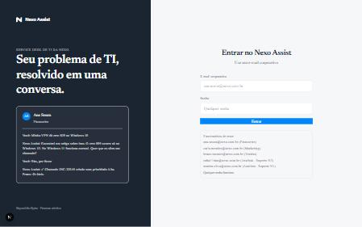
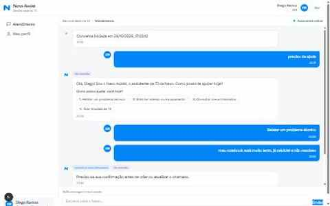
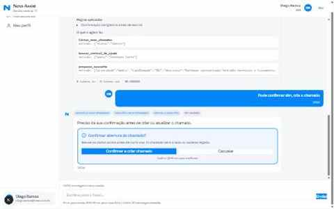
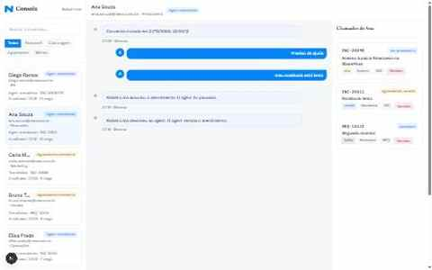

# Nexo Assist

Agent de atendimento de service desk de TI em chat, com console para analistas.

> Teste técnico — Beyond the Bytes

## Sumário

- [Visão Geral](#visão-geral)
- [Demonstração](#demonstração)
- [Tecnologias](#tecnologias)
- [Como Rodar](#como-rodar)
- [Scripts Disponíveis](#scripts-disponíveis)
- [Arquitetura](#arquitetura)
- [Como o Agent Decide](#como-o-agent-decide)
- [Transparência (3 Níveis)](#transparência-3-níveis)
- [Regras de Negócio Implementadas](#regras-de-negócio-implementadas)
- [Qualidade e Testes](#qualidade-e-testes)
- [Segurança e Privacidade](#segurança-e-privacidade)
- [Custo Estimado](#custo-estimado)
- [Trade-offs Principais](#trade-offs-principais)
- [O que Faria com Mais Tempo](#o-que-faria-com-mais-tempo)
- [Estrutura de Commits](#estrutura-de-commits)

## Visão Geral

O Nexo Assist é um agente conversacional que ajuda funcionários a resolver problemas de TI, consultar e abrir chamados, seguindo as regras do service desk da empresa Nexo. O projeto inclui:

- **Chat do funcionário**: Interface conversacional com streaming em tempo real
- **Console do analista**: Painel para gerenciar conversas transferidas
- **Agent transparente**: Cada decisão é explicada (o que entendeu, ação, confiança, por quê)
- **Serviço de chamados simulado**: Com falhas injetáveis para testar resiliência

## Demonstração

<!--
  TODO (preencher com a aplicação rodando via `npm run dev`):
  - [ ] Print: tela de login
  - [ ] Print: chat do funcionário (mensagem + chips de ação + painel de decisão expandido)
  - [ ] Print: card de confirmação de rascunho de chamado
  - [ ] Print: console do analista (lista de conversas + filtros)
  - [ ] GIF: fluxo completo "relatar problema → rascunho → confirmação → chamado criado"
  - [ ] GIF: transferência para analista (lado funcionário e lado analista)
  - [ ] Vídeo curto (1-2 min): tour geral pela aplicação
-->

### Capturas de Tela

| Login | Chat do Funcionário |
|---|---|
|  |  |

| Painel de Decisão do Agent | Console do Analista |
|---|---|
|  |  |

*(Capturadas com a aplicação rodando localmente: login, chat do funcionário com o agent, o painel "Ver decisão" com o card de confirmação do rascunho de chamado, e o console do analista.)*

## Tecnologias

- **Next.js 16** (App Router, Turbopack) + React 19 + TypeScript (strict, `noUncheckedIndexedAccess`)
- **Mastra** para o agent + **AI SDK** com Anthropic (Claude) / Google (Gemini)
- **SQLite** (`@libsql/client`) + **Drizzle ORM** para persistência
- **Tailwind CSS 4** com design tokens do protótipo
- **Vitest 5** para testes
- **jose** (JWT) para autenticação por sessão

## Como Rodar

```bash
# 1. Instalar dependências
npm install

# 2. Configurar variáveis de ambiente
cp .env.example .env
# Edite .env e adicione sua ANTHROPIC_API_KEY (ou GOOGLE_GENERATIVE_AI_API_KEY, conforme LLM_MODEL)

# 3. Criar banco e rodar migrations
npm run db:migrate

# 4. Popular com dados de exemplo
npm run db:seed

# 5. Iniciar servidor de desenvolvimento
npm run dev
```

Acesse `http://localhost:3000`

> **Nota:** os scripts em `scripts/` e `evals/` carregam o `.env` explicitamente (`import 'dotenv/config'`) porque são executados via `tsx`, fora do runtime do Next.js — que carrega `.env` automaticamente. Se `DB_PATH` não estiver definido no `.env`, eles caem no mesmo default usado por `src/db/index.ts` (`data/nexo-assist.db`), então **sempre confirme que `.env` existe antes de migrar/popular o banco**, para não acabar com dois arquivos de banco diferentes (um usado pelo `npm run dev`, outro pelos scripts).

### Credenciais de Demonstração

| Papel | E-mail | Senha |
|-------|--------|-------|
| Funcionário | ana.souza@nexo.com.br | qualquer |
| Funcionário | carla.mendes@nexo.com.br | qualquer |
| Analista (N2) | rafael.lima@nexo.com.br | qualquer |
| Analista (N1) | marina.silva@nexo.com.br | qualquer |

A senha não é validada nesta versão (ver [Trade-offs Principais](#trade-offs-principais)) — qualquer valor não vazio autentica pelo e-mail.

## Scripts Disponíveis

```bash
npm run dev          # Servidor de desenvolvimento
npm run build        # Build de produção
npm run start        # Servidor de produção
npm run typecheck    # Verificação de tipos TypeScript
npm run lint         # ESLint
npm run test         # Testes unitários (Vitest)
npm run eval         # Avaliação do agent com cenários reais
npm run db:generate  # Gerar migrations Drizzle
npm run db:migrate   # Rodar migrations
npm run db:seed      # Popular banco com dados de exemplo
npm run db:reset     # Zerar banco e recriar
```

## Arquitetura

```
src/
  app/                    # Interface: páginas Next.js + API routes
    (auth)/login          # Login
    (employee)/chat       # Chat do funcionário
    (employee)/perfil     # Perfil do funcionário
    (analyst)/console     # Console do analista
    api/                  # API routes (chat, drafts, auth, analyst)
  components/             # UI components
  agent/                  # Agent Mastra
    nexo-agent.ts         # Definição do agent
    tools/                # Tools (buscar_central, listar_chamados, etc.)
    decision.ts           # Schema Zod da decisão estruturada
    guardrails.ts         # Regras determinísticas
    prompts/              # System prompt versionado
  services/               # Serviços (separados do agent)
    tickets/              # Cliente do sistema legado simulado
    helpdesk/             # Central de ajuda (busca BM25)
    conversations/        # Conversas, máquina de estados
    sla.ts                # Cálculo determinístico de SLA
    auth/                 # Autenticação JWT
  db/                     # Schema Drizzle + migrations
  lib/                    # Utilitários (clock, errors, logger)
tests/                    # Testes unitários
evals/                    # Cenários de avaliação do agent
```

### Regras de Dependência

`app → agent → services → db` (nunca o contrário). O serviço de tickets **não conhece** o agent.

## Como o Agent Decide

### Fluxo por Mensagem

1. **Autenticação** → obtém `userId` da sessão
2. **Carrega conversa** → se estado ≠ `agent`, não invoca LLM
3. **Limite de 30 msgs** → se atingiu, oferece nova sessão ou analista
4. **Invoca agent** com: histórico recente, perfil, data/hora
5. **Agent usa tools** e retorna `AgentTurn` estruturado
6. **Guardrails** validam: confiança ≥ 0.6, confirmação para escrita, estado da conversa
7. **Persiste** mensagem + trace de decisão, transmite por streaming

### Tools Disponíveis

| Tool | Descrição |
|------|-----------|
| `buscar_central_de_ajuda` | Busca artigos (BM25) |
| `listar_meus_chamados` | Lista chamados do usuário com SLA |
| `obter_chamado` | Detalhes de um chamado (só se for do usuário) |
| `preparar_rascunho` | Cria rascunho (D-xxx) para confirmação |
| `transferir_para_analista` | Muda estado para `aguardando_atendente` |
| `perguntar_ao_usuario` | Opções rápidas numeradas (1-4) |

### Saída Estruturada (AgentTurn)

```json
{
  "message": "Texto para o usuário",
  "ui": { "kind": "options", "question": "...", "options": ["1", "2"] },
  "decision": {
    "intent": "abrir_chamado",
    "understood": "Usuário quer relatar notebook lento",
    "action": "Preparar rascunho de INC/Hardware/Média",
    "confidence": 0.87,
    "reasoning": "Sintomas indicam problema de hardware, prioridade média por atrapalhar mas ter alternativa",
    "rulesApplied": ["Sem duplicidade", "Prioridade média: atrapalha mas há alternativa"]
  }
}
```

### Guardrails (Código Determinístico)

- Confiança < 0.6 → **transferência forçada** para analista
- Ação de escrita sem confirmação → **bloqueada**
- Conversa não está com agent → **LLM não é chamado**

## Transparência (3 Níveis)

1. **Chips de ação** acima de cada resposta: "consultou seus chamados", "classificou prioridade", etc.
2. **Painel de decisão** expansível: o que entendi, ação, confiança (barra), por quê, regras aplicadas
3. **Log estruturado** JSON no servidor por request

## Regras de Negócio Implementadas

- **Tipos**: INC (incidente) / REQ (requisição)
- **Categorias**: Acesso, Rede e VPN, Hardware, Software, E-mail, Outros
- **Prioridade = Impacto × Urgência** com prazos em horas úteis (seg-sex 8h-18h)
- **Sem duplicidade**: busca chamados abertos antes de rascunhar
- **Reabertura**: ≤ 7 dias resolvido → reabre; > 7 dias → novo chamado
- **Transferência**: usuário pede, caso crítico, vencido (se aceita), baixa confiança
- **Privacidade**: isolamento total por `requesterId` da sessão
- **Escopo**: só TI; RH/financeiro/facilities → redireciona sem abrir chamado

## Qualidade e Testes

### Unitários (Vitest)
- `sla.ts`: horas úteis, fins de semana, crítico em horas corridas, relógio injetável
- Máquina de estados da conversa
- Guardrails (confiança, confirmação, agent pausado)
- Duplicidade e janela de 7 dias
- Privacidade (usuário A nunca lê chamado do B)
- Idempotência de confirmação
- Retry/timeout do client legado

43/43 testes passando (`npm run test`), rodando contra o mesmo banco (`DB_PATH` do `.env`) usado por `npm run dev` — ver nota de configuração do Vitest em [Trade-offs Principais](#trade-offs-principais).

### Avaliação do Agent (`npm run eval`)
20+ cenários com modelo real:
- VPN erro 809 + Windows 11 → rascunho INC/Rede e VPN
- Dúvida senha Wi-Fi → resposta pela central **sem** abrir chamado
- Férias → redireciona (RH)
- Chamado vencido → oferece analista
- Duplicado aberto → atualiza em vez de duplicar
- Resolvido há 3 dias → reabre; 10 dias → novo
- Tentativa ver chamado de outro → recusa
- Legado fora → avisa sem inventar
- Prioridade: compromisso hoje → Alta; equipe parada → Crítica + transferência
- Baixa confiança → transferência

## Segurança e Privacidade

- Chaves só em `.env` (`.gitignore`); `.env.example` completo
- Identidade do usuário **nunca** é parâmetro de tool (vem da sessão)
- Isolamento: toda leitura filtra por `requester = sessão`
- Rate limit por usuário/IP nas rotas de chat/login
- Teto global de gasto diário (desliga agent se estourar)
- Logs sem e-mails completos (hash com salt)

## Custo Estimado

- Modelo padrão: **Claude 3.5 Haiku** (configurável via `LLM_MODEL`, ex.: `google/gemini-3.8-flash`)
- Conversa típica (8-12 turns): ~$0.001-0.003 (Haiku) ou gratuito (tier free do Gemini)
- Janela de histórico limitada + resumo para controlar custo
- Prompt caching do system prompt quando suportado

## Trade-offs Principais

| Decisão | Justificativa |
|---------|---------------|
| SQLite em arquivo | Simplicidade, persistência local, atende requisito de sobrevivência a reinício |
| BM25 em vez de embeddings | Suficiente para 8-10 artigos; sem dependência externa; determinístico |
| Feriados ignorados no SLA | Trade-off declarado; simplifica cálculo |
| SSE não implementado (polling) | Simplicidade no Next.js App Router; polling de 2s para tempo real analista→funcionário |
| Haiku/Gemini Flash como default | Custo baixo (ou gratuito); qualidade suficiente para classificação e tools |
| Senha não validada no login | Fora do escopo do desafio (autenticação simulada); autenticação real exigiria hash+salt e fluxo de recuperação, não priorizado frente às regras de negócio do service desk |
| Scripts fora do Next.js carregam `.env` manualmente | `tsx` (migrate/seed/reset) e Vitest não carregam `.env` como o runtime do Next.js faz — cada um importa `dotenv/config` explicitamente para garantir que apontam para o mesmo banco que `npm run dev` usa |

## O que Faria com Mais Tempo

- [ ] Deploy no Railway/Fly.io com volume persistente para SQLite
- [ ] Testes de integração E2E (Playwright)
- [ ] Cache de embeddings para busca semântica na central de ajuda
- [ ] Métricas de observabilidade (latência, tokens, custos por conversa)
- [ ] Internacionalização (i18n)
- [ ] Acessibilidade completa (WCAG 2.1 AA)
- [ ] Notificações push/email para analista quando transferido
- [ ] Remover os últimos usos de `any` não essenciais (mapeamento de linhas de JOIN manual) adicionando tipos de linha explícitos por query

## Estrutura de Commits

Commits seguem **Conventional Commits**:

```
feat(tickets): serviço simulado com falhas injetáveis
feat(agent): tools com Zod + saída estruturada AgentTurn
feat(chat): streaming + chips de ação + painel de decisão
feat(console): lista/filtros + assumir/devolver/encerrar
fix(auth): carrega DB_PATH do .env em scripts tsx (migrate/seed/reset)
fix(tickets): usa dueAt persistido em vez de recalcular a partir de createdAt
test(sla): cobertura completa de horas úteis e edge cases
eval: 20 cenários + relatório de confiança média
docs: README com arquitetura, decisões, trade-offs e demonstração
```

## Licença

Teste técnico - Beyond the Bytes
